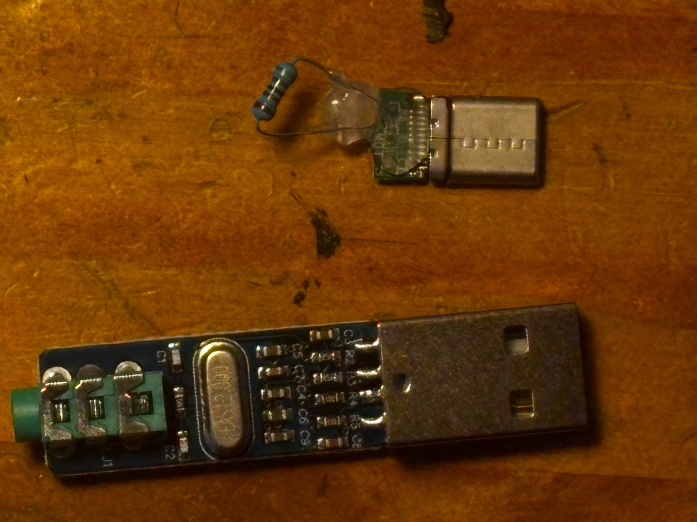
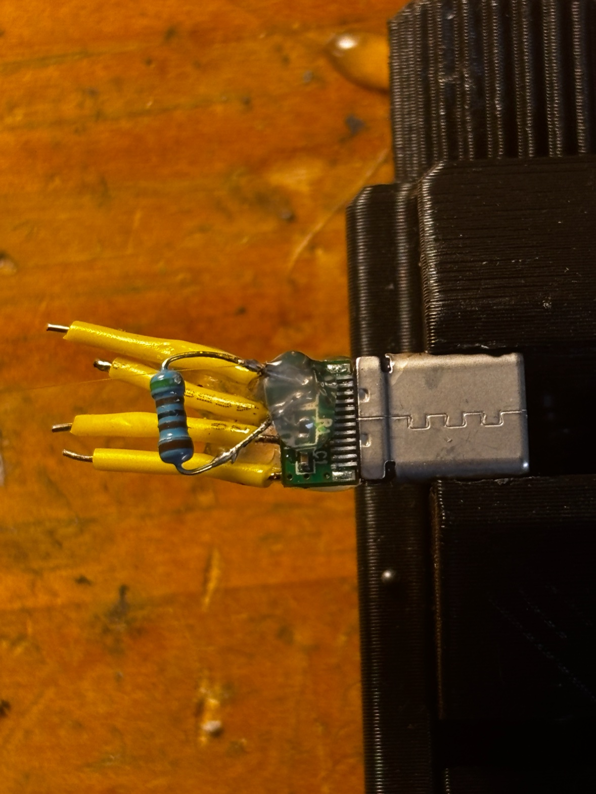
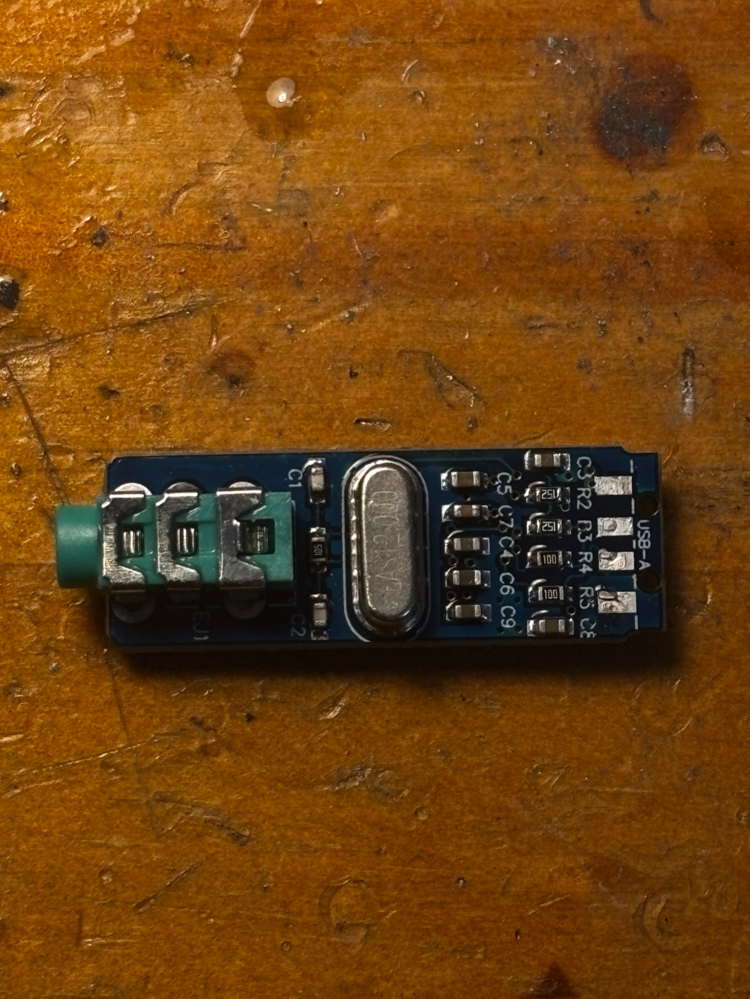
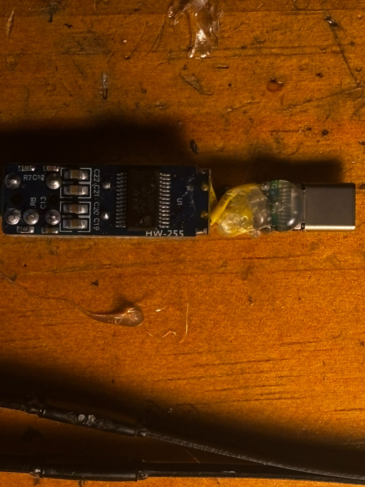
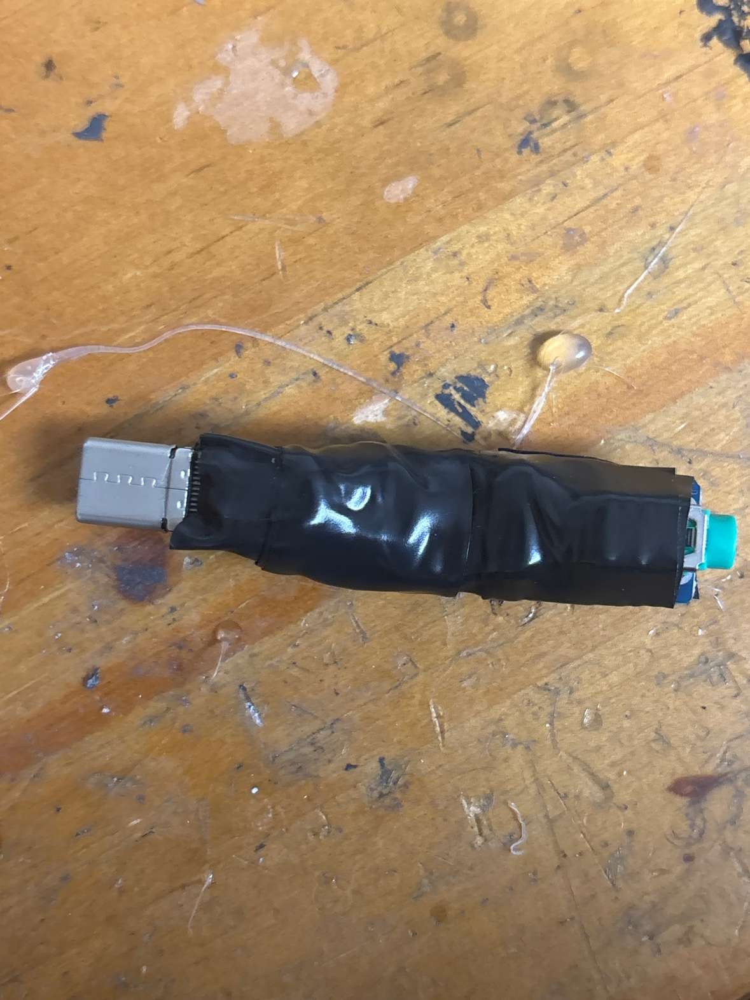
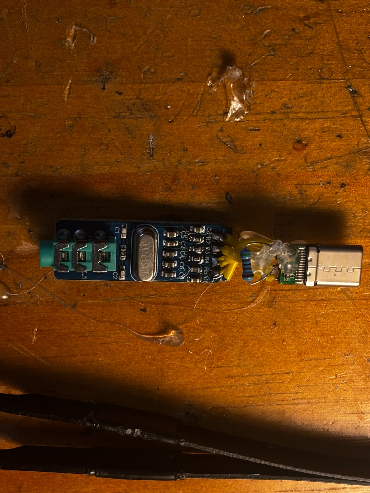

# USB-C to 3.5mm DAC Adapter

A USB-C to 3.5mm headphone adapter built from separate boards soldered together for soldering practice.

## The idea

- USB-C breakout board (already owned) → PCM2704 DAC board → headphones.
- The DAC board has a 3.5mm jack built in, so no separate jack is needed.
- Why a DAC and not just wires: the iPhone doesn't do passive analog audio over USB-C, so the phone has to send digital USB audio to a DAC chip.

## What I already own: the USB-C breakout board

- Male USB-C plug breakout, "ZMO" silkscreen.
- Breakout board link: https://www.amazon.com/dp/B0D9W8B97B (MTDELE 10-pack — 5 male + 5 female, $6.99, Amazon).
- Back pads: only G, D+, D-, V. No SBU pads on the back.
- Front: R1 (populated), R2 (empty pads), C1 (populated).
- CC lines are NOT on the back pads:
  - R1 = CC1 (pin A5), populated with a 5.1kΩ pull-down.
  - R2 = CC2 (pin B5 / VCONN), empty pads.
  - Both CC lines are now tied with 5.1kΩ through-hole resistors soldered to the CC pins and secured with hot glue (done 2026-11-14).
- 5.1kΩ tells the phone "USB device" (UFP) — correct for the DAC path. Passive analog audio mode would need <1kΩ on CC; with 5.1kΩ the phone attempts USB enumeration and produces no analog audio.
- To tap a CC signal, solder at the R1/R2 pads.

## DAC vs passive (why DAC)

- Passive (wires only): phone outputs analog audio on D+/D-. Cheap, no latency, but phone-dependent — works on most Android, NOT on iPhone. Sound quality = phone's internal DAC.
- DAC: phone sends digital USB audio to a DAC chip in the adapter. Works on any phone including iPhone, sound quality = the DAC chip, can do mic, needs the chip + supporting parts + USB power, negligible latency.
- Decision: DAC (2026-11-14).

## The DAC board — ordered

- **Hailege 2pcs 5V PCM2704 Sound Card Decoding Module DAC Decoder Board, $16.99 for 2 ($8.50 each), Amazon. Ordered 2026-11-15, arrives Tuesday Nov 17. $17.71 including tax, paid with gift card. Sold by Hailege US, ships from Amazon.**
- Link: https://www.amazon.com/gp/product/B08D7D7KX4/ref=ox_sc_act_title_1?smid=A2F7ULK8PUMGS&psc=1
- This is a 2-pack of bare PCM2704 boards on Amazon, found with the search terms below. (Earlier I thought no PCM2704 multi-pack existed on Amazon; this listing proves otherwise.)
- Chip: TI PCM2704 — 16-bit / 48 kHz USB Audio Class 1.0 DAC + headphone amp
- The board has a USB-A male plug on one end and a green 3.5mm jack on the other, with a 12.000 MHz crystal on board.
- Caveat: cheap PCM2704 boards can have flaky USB descriptors and iOS is pickier than a computer — if it doesn't enumerate, that's the board, not the wiring.

## Wiring

- USB-C breakout → DAC board USB-A connector pins: V → pin 1 (5V), D- → pin 2, D+ → pin 3, G → pin 4 (GND).
- Desolder the USB-A connector from the DAC board and solder the four wires to the connector pads.
- Headphones plug straight into the DAC board's built-in jack — no DAC-to-jack wiring.

## Soldering

Photos go in `docs/images/` — add them with the filenames below and they'll show up here.

0. **Test both boards stock first** — Plug each board's USB-A plug straight into a computer, plug headphones into its built-in jack, and check it shows up as a USB audio output (Mac: System Settings → Sound → Output) and plays sound. Test both — it takes two minutes. Desolder only a board that passed. If one is a dud, that's the board, not your wiring, and you still have the good one untouched.

   

1. **CC resistors** — Solder 5.1kΩ through-hole resistors to the CC pins on the USB-C breakout (R1 = CC1, R2 = CC2), then secure them with hot glue so they don't move or short.

   

2. **Desolder the USB-A connector** — Remove the USB-A plug from the DAC board (see "Desoldering the USB-A connector" above). Clean the pads with wick + flux.

   

3. **Wire the breakout to the DAC board** — Solder four wires from the breakout to the DAC board's USB-A pads: V → pin 1 (5V), D- → pin 2, D+ → pin 3, G → pin 4 (GND).

   

4. **Wrap it** — Surround the whole wired assembly with electrical tape, then hot glue over it to hold everything in place and insulate the connections.

   

5. **Test** — Plug the USB-C end into the phone, check the DAC shows up, then plug headphones into the board's jack.

   

## Desoldering the USB-A connector

- The USB-A plug is through-hole: 4 signal pins + 2 shell/ground tabs (6 joints).
- Add flux and fresh solder to each joint first — fresh solder helps heat transfer and lowers the melting point of the old lead-free solder.
- Heat each joint and remove the solder with solder wick or a desoldering pump.
- The 2 shell tabs are the hard part — they're soldered to large ground pours that sink heat. Use a bigger tip, higher temp (~380°C), and be patient.
- Don't pull the connector until all 6 joints are free — forcing it rips pads off the board. If a pin won't come free, add more solder and try again.
- After removal, clean the pads with wick + flux, then solder the 4 wires to the signal pads.
- Before powering: double-check 5V vs GND with a multimeter (GND pad should show continuity to the jack's ground / the big ground pour). Mixing up D- and D+ just stops enumeration and is an easy swap; mixing up 5V and GND can damage the board.

## Sourcing / search terms

- Want: packs of boards, ideally on Amazon, NOT AliExpress.
- Amazon search terms that found the Hailege 2-pack: `PCM2704 DAC board pack`, `mini USB sound card module 5 pack`, `USB DAC decoder board 2 pack`, `PCM2704 USB DAC module lot`, `mini USB audio adapter board pack`, `USB sound card DIY module pack`.
- Cheapest single board found earlier: mini PCM2704 board, $4.46 (AliExpress). Confirmed-3.5mm alternative: PCM2704 board with "3.5mm Analog" in the name, $6.83 (AliExpress). A 5-pack link mentioned earlier ($11.11 for 5) was Walmart, not Amazon.
- Other boards found (Meta Catalog, 2026-11-14): Aomoproing PCM2704 with 3.5mm $12.39; SMUGDESK PCM2704 with 3.5mm $17.49; Drrntien mini PCM2704 (Walmart) $11.93 — USB-A input, 3.5mm unconfirmed; DIY Type-C DAC module (mickcara) $16; ES9038 Type-C to 3.5mm $21.98.
- Separate 3.5mm jacks (not needed if the DAC board has one built in): Adafruit breadboard-friendly 3.5mm stereo jack $0.95; Boffintronics 3.5mm jack breakout kit $1.29 (solder the jack onto the PCB yourself — good soldering practice); ShillehTek pre-soldered 3.5mm breakout $6.99.

## From-scratch DAC spec (if building the DAC board instead of buying one)

- TI PCM2704 (32-pin TQFP), 12 MHz crystal + 2× 22 pF, 3.3 V LDO, decoupling + 10 µF bulk, 100 µF output coupling caps. PCM2912 sibling if mic wanted. Check the PCM2704 datasheet for exact pin numbers.

## Passive wiring reference (for reference only — not the chosen path)

- Audio Accessory Mode, CTIA TRRS: D+ → Tip (Left); D- → Ring 1 (Right); GND → Ring 2 (Ground); SBU1 (A8) → Sleeve (Mic); CC1/CC2 → GND via <1kΩ or short; VBUS unconnected; SBU2 (B8) → GND.
- Catch: the breakout board has no SBU1 pad, so stereo-only works from the back pads; mic needs soldering directly to the connector's A8 pin. Passive only works on phones supporting Audio Accessory Mode (most Android; NOT iPhone).
